# EcoGestión — Presentación de defensa de tesis

Contenido en texto de `PRESENTACION_TESIS.pptx` (título, bullets y notas del orador por diapositiva).

## Diapositiva 1: EcoGestión

**Sistema de trazabilidad de bolsas de residuos hospitalarios**

- Defensa de Tesis
- Autores: [Nombre y apellido] · [Nombre y apellido]
- Noviembre 2026

> **Notas del orador:** Presentación del trabajo final: un sistema web que registra el ciclo de vida completo de cada bolsa de residuos hospitalarios, desde que ingresa como insumo hasta su tratamiento y disposición final por el operador externo (DGM). Completar nombres de autores, director/a e institución antes de la defensa.

## Diapositiva 2: Problema y objetivo

- **Problema**
  - Los residuos hospitalarios están regulados y exigen respaldo documental de cada etapa
  - El seguimiento manual (planillas, remitos en papel) dificulta detectar faltantes y diferencias
  - No hay una vista unificada de stock, residuos en depósito y pendientes de retiro
- **Objetivo**
  - Trazar cada bolsa individualmente por su código de barras, desde la recepción hasta la disposición final
  - Registrar quién hizo cada operación y cuándo (auditoría por bolsa)
  - Detectar y registrar automáticamente las discrepancias como incidencias
  - Centralizar la documentación: remitos, manifiestos finales y reportes

> **Notas del orador:** El hospital recibe bolsas como insumo, las entrega a los servicios, éstas vuelven llenas al depósito de residuos, se pesan y las retira la empresa DGM para su tratamiento. El sistema convierte cada uno de esos pasos en una transición de estado registrada y auditada, de modo que en cualquier momento se puede saber dónde está cada bolsa y qué falta conciliar.

## Diapositiva 3: Stack técnico

- **Backend**
  - Laravel 13 (PHP 8.3+)
  - Laravel Fortify: autenticación y 2FA
  - Spatie laravel-permission: roles y permisos
  - DomPDF: remitos en PDF
  - Laravel Excel: exportación de bolsas
- **Frontend**
  - Inertia.js v3 (SPA sin API REST separada)
  - React 19 + TypeScript
  - Tailwind CSS 4 + shadcn/ui (Radix UI)
  - Recharts: gráficos de dashboard y reportes
  - Laravel Wayfinder: rutas tipadas en TS
- **Datos**
  - MySQL (conexión configurada en config/database.php)
  - SQLite por defecto en .env.example para desarrollo
  - Migraciones y seeders con datos de prueba
  - Eloquent ORM con casts a enums

> **Notas del orador:** Laravel resuelve la lógica de negocio, validación y transacciones; Inertia permite renderizar páginas React directamente desde los controladores, sin mantener una API REST aparte. TypeScript y Wayfinder dan tipado de extremo a extremo para rutas.

## Diapositiva 4: Flujo principal: ciclo de vida de una bolsa

Diagrama del ciclo de vida (enum `EstadoBolsa`):

```mermaid
stateDiagram-v2
    direction LR
    [*] --> RECIBIDA: Alta remito de recepción
    RECIBIDA --> DISPONIBLE: Control Recepción (escaneo)
    DISPONIBLE --> ENTREGADA_A_SERVICIO: Remito entrega a servicio
    ENTREGADA_A_SERVICIO --> INGRESADA_AL_DEPOSITO: Recepción en depósito
    INGRESADA_AL_DEPOSITO --> PESADA: Pesaje (kg)
    PESADA --> DESPACHADA: Remito de salida
    DESPACHADA --> RETIRADA_POR_DGM: Conciliación DGM
    RETIRADA_POR_DGM --> TRATADA_DISPOSICION_FINAL: Manifiesto final
    RECIBIDA --> NO_RECIBIDA: Faltante en control (incidencia)
    TRATADA_DISPOSICION_FINAL --> [*]
```

- Remito de recepción: PENDIENTE_CONTROL → CONCILIADO (al confirmar el Control Recepción)
- Remito de salida: PENDIENTE_RETIRO → CONCILIADO / CON_INCIDENCIA → FINALIZADO (con manifiesto); ANULADO devuelve las bolsas a PESADA
- Cada transición: validación del estado previo + transacción + registro en auditoría

> **Notas del orador:** 1) Al cargar el remito de recepción se dan de alta los códigos (13 dígitos, únicos) y las bolsas nacen RECIBIDA; el remito queda PENDIENTE_CONTROL. 2) En Control Recepción se escanean físicamente: las escaneadas pasan a DISPONIBLE, las declaradas no escaneadas a NO_RECIBIDA (incidencia BOLSA_FALTANTE_RECEPCION) y los códigos ajenos al remito generan BOLSA_SOBRANTE_RECEPCION; el remito pasa a CONCILIADO. 3) El remito de entrega a servicio solo acepta bolsas DISPONIBLE → ENTREGADA_A_SERVICIO. 4) La recepción en depósito exige que la bolsa haya sido entregada a un servicio → INGRESADA_AL_DEPOSITO. 5) El pesaje registra los kilogramos → PESADA. 6) El remito de salida agrupa bolsas PESADA → DESPACHADA. 7) Al conciliar con el remito de DGM se comparan cantidades; las bolsas pasan a RETIRADA_POR_DGM y, si difieren, se crea DIFERENCIA_CONCILIACION_DGM. 8) Al registrar el manifiesto final las bolsas quedan TRATADA_DISPOSICION_FINAL. El enum incluye además UTILIZADA, hoy sin uso en el flujo.

## Diapositiva 5: Módulos de soporte

- **Incidencias: 16 tipos (enum TipoIncidencia), 9 de carga manual**
  - Automáticas: faltante/sobrante en recepción y diferencia de conciliación DGM
  - Resolución: ABIERTA → EN_ANALISIS → RESUELTA / CERRADA
- **Auditorías: AuditoriaService registra operación, valor anterior y nuevo (JSON), responsable y fecha/hora por bolsa**
- **Manifiestos finales: solo sobre remitos conciliados; documento PDF/imagen obligatorio (máx. 5 MB)**
- **Dashboard: bolsas recibidas, utilizadas y retiradas del mes, kg generados, stock de vacías, residuos en depósito y pendientes (pesaje, retiro, documentación)**
- **Reportes: estadísticas por período, exportación a Excel y remitos en PDF**
- **Roles y permisos: 6 roles y 54 permisos granulares (Spatie) + Policies; cambio de contraseña obligatorio en el primer ingreso**

> **Notas del orador:** Roles sembrados: admin, recepcion-insumos, servicios, deposito-residuos, area-ambiental y administracion. Los permisos se verifican tanto en middleware de rutas (por ejemplo 'controlar remitosRecepcion', 'conciliar remitosSalida') como en Policies. El middleware EnsurePasswordIsChanged obliga a rotar la contraseña inicial cuando el flag must_change_password está activo. La auditoría permite reconstruir la historia completa de cualquier bolsa.

## Diapositiva 6: Decisiones técnicas destacadas

- **Escaneo por código de barras (ScannerInput)**
  - El lector actúa como teclado: Enter dispara la lectura y el foco se mantiene para escaneos seguidos
  - Endpoints api/bolsas/* validan que la bolsa esté en el estado esperado para cada etapa
- **Conciliación automática**
  - Recepción: escaneadas vs. declaradas; DGM: cantidad del sistema vs. declarada por la empresa
  - Transacciones con lockForUpdate para evitar dobles controles concurrentes
- **Enum de estados EstadoBolsa (PHP backed enum)**
  - Cast en el modelo, etiquetas legibles y agrupaciones reutilizadas en KPIs y reportes
- **Tema claro/oscuro con tokens semánticos**
  - Variables CSS (background, primary, muted, destructive…) mapeadas en Tailwind 4; modo light/dark/system persistido en cookie

> **Notas del orador:** El ScannerInput es un único componente reutilizado en Control Recepción, entrega a servicio, recepción y pesaje en depósito y remito de salida. Centralizar los estados en un enum evita cadenas sueltas y permite que el dashboard y los reportes usen las mismas definiciones (recibidas, utilizadas, retiradas, en depósito). El tema usa tokens semánticos en lugar de colores fijos, por lo que cada componente se adapta solo al modo oscuro.

## Diapositiva 7: Limitaciones conocidas y próximos pasos

- **Limitaciones**
  - Tests automatizados centrados en autenticación, ajustes, administración y dashboard; falta cubrir el flujo de bolsas
  - El estado UTILIZADA está definido en el enum pero no participa del flujo actual
  - La conciliación con DGM y el pesaje se cargan manualmente
- **Próximos pasos**
  - Tests de integración para cada transición de estado y generación de incidencias
  - Integración con balanza y con el sistema del operador DGM
  - Alertas y notificaciones sobre incidencias abiertas y pendientes de retiro
  - Versión móvil/PWA para escanear en los servicios y en el depósito

> **Notas del orador:** Cerrar destacando que el núcleo del flujo (recepción, control, entrega, depósito, pesaje, despacho, conciliación y manifiesto) está implementado de punta a punta con auditoría, y que los próximos pasos apuntan a robustez (tests) e integración con dispositivos y actores externos.
